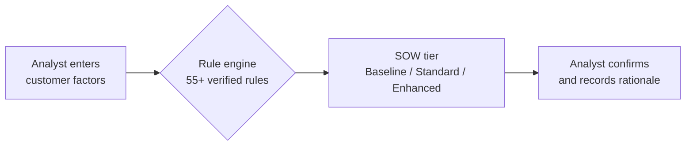
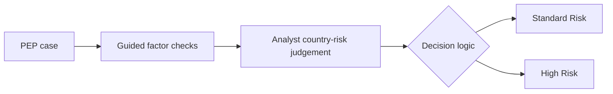
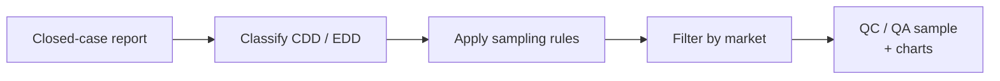
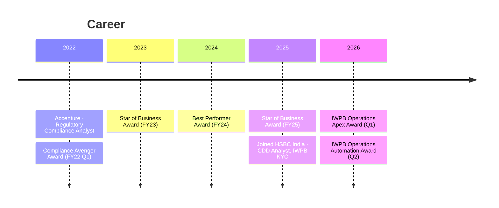

# Tej Thimmaiah

  
  
  
  
  

---

## About me

I'm a financial crime compliance analyst with **4.5 years** at **HSBC** and **Accenture**, working across CDD/EDD, KYC, transaction monitoring, SAR investigations and sanctions screening.

At HSBC I complete **8+ end-to-end CDD/EDD reviews a day with 100% QA accuracy** for the Channel Islands & Isle of Man (CIIOM) market. Alongside casework, I build the tools that make KYC faster and more consistent. Three of them are now **approved and used across all markets**, and they earned the **IWPB Operations Automation Award (Q2 2026)**.

<table>
  <tr>
    <td align="center" width="25%"><h3>8+</h3>CDD/EDD reviews per day</td>
    <td align="center" width="25%"><h3>100%</h3>QA accuracy</td>
    <td align="center" width="25%"><h3>&lt; 1.5 min</h3>per case with my decision tools</td>
    <td align="center" width="25%"><h3>6</h3>performance awards in 4.5 years</td>
  </tr>
</table>

---

## Tools I built at HSBC

> Click a tool to see what it does and how it works. Descriptions are kept high level; no internal rules, data or client information are shared here.

<b>🧭 Source of Wealth Tier Identification Tool</b> &nbsp;·&nbsp; Excel / VBA rule engine &nbsp;·&nbsp; used across all markets

 

**Problem:** Deciding how much Source of Wealth evidence a customer needs meant reading a multi-factor policy matrix by hand for every case. It was slow and analysts could reach different answers.

**What I built:** A single-sheet rule engine. The analyst answers a short set of questions about the customer; the tool returns the SOW tier (Baseline / Standard / Enhanced) with the matching rule, in **under 1.5 minutes**.

- Encodes **55+ policy rules**, each verified against the master matrix and tested with scenario runs
- Locked formulas and workbook structure so the logic can't be changed by accident
- One-click reset so every new case starts from a clean, consistent default
- The analyst still reviews and owns the final decision

<b>🛡️ PEP Standard vs High Risk Decision Tool</b> &nbsp;·&nbsp; used across all markets and by Onshore Safeguard teams

 

**Problem:** Classifying a Politically Exposed Person as Standard or High Risk depends on several factors, and inconsistent decisions create audit risk.

**What I built:** A guided decision tool that walks the analyst through the required factors and returns a consistent PEP risk outcome in **under 1.5 minutes**. Country risk stays a manual analyst judgement, because the reference list changes over time.

- Approved by management and adopted beyond my own team by the **Onshore Safeguard teams**
- Built to production standard from the requirements sheet, then refined with stakeholder feedback

<b>🎯 CDD/EDD QC/QA Sampling Tool</b> &nbsp;·&nbsp; one-click &nbsp;·&nbsp; used daily by QC teams across markets

 

**Problem:** QC and QA analysts had to work out by hand which closed cases needed a quality check, and what share of the closed report was CDD vs EDD.

**What I built:** A one-click tool that reads the closed-case report, applies the sampling rules (**20% of EDD, 10% of CDD, plus all high-risk third country customers**) and filters by market, so each QC team sees only its own sample. It includes a charts view of the CDD/EDD split.

<b>📊 Team performance dashboards</b> &nbsp;·&nbsp; Power BI + Power Automate &nbsp;·&nbsp; team of 17

 

Daily and monthly MI on productivity, quality and SLA performance, refreshed automatically, giving team leads clear visibility without manual reporting.

---

## Experience

<b>HSBC India</b> · Customer Due Diligence (CDD) Analyst, IWPB KYC · <i>Jul 2025 – Present</i>

 

- End-to-end CDD/EDD reviews for the **CIIOM** market: ID&V, beneficial ownership, source of wealth / source of funds, PEP, sanctions and adverse-media checks, customer risk rating
- **8+ reviews a day with 100% QA accuracy**; periodic and trigger-event reviews within SLA
- Raise **Unusual Activity Reports (UARs)** when a customer's transactions look suspicious during review
- Designed and built three KYC decision and QC tools now **used across all markets**
- Built Power BI / Power Automate MI for a **team of 17**
- Support the QC team with quality checks; track team e-learning and monthly knowledge-test completion

<b>Accenture</b> · Regulatory Compliance Analyst · <i>Apr 2022 – Jun 2025</i>

 

- Investigated **10–15 transaction monitoring alerts a day** for a US client (Google), tracing the origin and destination of funds
- Authored and filed **8+ Suspicious Activity Reports (SARs) per quarter** with narrative, evidence and escalation recommendation
- Sanctions, PEP and watchlist screening across multiple tools
- KYC, KYB and CDD reviews and onboarding verification, including fraudulent document detection
- KYC quality reviews and process improvement; earned the Accenture **People Leadership Credential (Level 1)**

---

## Awards

| Award | Issued by | Date |
|---|---|---|
| 🤖 IWPB Operations **Automation** Award, Q2 2026 | HSBC | Sep 2026 |
| 🏆 IWPB Operations **Apex** Award, Q1 2026 | HSBC | May 2026 |
| 🌟 Star of Business, FY25 | Accenture | Jun 2025 |
| 🥇 Best Performer, FY24 | Accenture | Sep 2024 |
| 🌟 Star of Business, FY23 | Accenture | Sep 2023 |
| 🛡️ Compliance Avenger, FY22 Q1 | Accenture | Aug 2022 |

---

## Skills

<table>
  <tr>
    <td valign="top" width="33%">
      <b>Financial crime</b>  
      CDD / EDD · KYC / KYB 
      Beneficial ownership 
      Source of wealth / funds 
      PEP assessment 
      Sanctions &amp; adverse media 
      Customer risk rating
    </td>
    <td valign="top" width="33%">
      <b>Investigations</b>  
      Transaction monitoring 
      Fund tracing 
      SAR writing &amp; filing 
      Unusual Activity Reports (UAR) 
      Fraudulent document detection 
      Audit-ready documentation
    </td>
    <td valign="top" width="33%">
      <b>Automation &amp; data</b>  
      
      
      
      
      
      
      
      
    </td>
  </tr>
</table>

---

## Founder · Bastion Helix

  

 

Alongside my compliance career, I founded **[Bastion Helix](https://bastionhelix.com)**, an independent software company in Bengaluru. It builds apps for the tools teams already use: Chrome, Jira and AI agents. I design, build and launch the products myself.

<table>
  <tr>
    <td valign="top" width="50%">
      <b>📸 <a href="https://bastionhelix.com/capture">Bastion Helix Capture</a></b> 
        
      Chrome extension that sends bug reports with screenshots or replays straight to Jira, GitHub or Linear.
    </td>
    <td valign="top" width="50%">
      <b>📋 <a href="https://bastionhelix.com/tables">Bastion Helix Tables</a></b> 
        
      Chrome and Edge extension that turns any web table into Excel, CSV or Google Sheets data in one click.
    </td>
  </tr>
  <tr>
    <td valign="top" width="50%">
      <b>🔎 <a href="https://bastionhelix.com/lens">Bastion Helix Agent Lens</a></b> 
        
      API and MCP server that lets AI agents check whether they may use a web page, then read its content.
    </td>
    <td valign="top" width="50%">
      <b>🧩 <a href="https://bastionhelix.com/jira">Bastion Helix for Jira</a></b> 
        
      Seven Jira Cloud tools on one licence, running inside Atlassian.
    </td>
  </tr>
</table>

  

---

## Personal projects

Private builds. Code is not public.

| Project | What it is | Built with |
|---|---|---|
| **Finance Meridian** | Finance education website, including a "Jargon Buster" that explains financial terms in plain language | HTML, AI API |
| **Nifty 50 short-sell agent** | Agent that scans Nifty 50 stocks for short-sell signals | Python |

---

## Education &amp; certifications

<b>Education</b>

 

| Degree | Institution | Years | Score |
|---|---|---|---|
| MBA, HR Management &amp; Finance | Jain (Deemed-to-be University), Bengaluru | 2021 – 2023 | 71.82% |
| B.Com, Accounting &amp; Taxation | New Horizon College, Bengaluru | 2017 – 2020 | 83.35% |

<b>Certifications</b>

 

- UiPath Automation Business Analyst Associate, UiPath Academy (Jun 2025)
- People Leadership Credential, Level 1, Accenture (Apr 2025)
- Accounting Fundamentals, Corporate Finance Institute (Feb 2022)
- Advanced Microsoft Excel, Systems Domain (May 2020)
- Cybersecurity fundamentals: Palo Alto Networks, Fortinet, Microsoft &amp; LinkedIn (2025)

---

## Building in public

**488 contributions in the last year** · **3 live products under Bastion Helix** · **3 tools in live use at HSBC**

  <picture>
    <source media="(prefers-color-scheme: dark)" srcset="https://raw.githubusercontent.com/TejThimmaiah/TejThimmaiah/output/github-contribution-grid-snake-dark.svg" />
    
  </picture>

---

  <b>Open to AML, KYC, transaction monitoring and financial crime roles in Bengaluru.</b> 
  <a href="https://www.linkedin.com/in/tejthimmaiah/">LinkedIn</a> · <a href="mailto:thimmaiah18tej@gmail.com">thimmaiah18tej@gmail.com</a>

